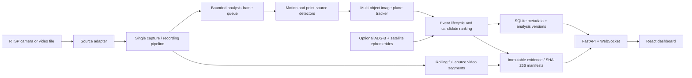

# UAP Observer — Stationary Camera Detection and Evidence System

**Codex implementation handoff | Version 1.1 planning specification | 2026-10-24**  
**Status:** Design and implementation requirements, not a claim that any code or camera integration is already working.  
**Owner's existing hardware:** One Aqara Camera G100, currently added to Apple Home.  
**Development target:** The owner’s existing computer; verify its OS, CPU architecture, memory and available storage before implementation. Keep macOS support and future Linux portability without requiring a new machine.  
**Scope:** Fixed/stationary cameras only. No PTZ, moving mount, telescope, custom PCB, or extra hardware purchase is required to begin.

---

## 1. Our vision / idea

We want to build **our own complete UAP (unidentified anomalous phenomena) observation and detection software**, using affordable, commercially available cameras. The system must not be a skin over Sky360, Frigate, Blue Iris, or any other UAP surveillance software. We can use general-purpose open-source libraries for video decoding, computer vision, astronomy, web development, and databases; the application logic, event model, processing pipeline, tracking, classification, evidence management, and UI must be ours.

The idea is simple:

> Point one or more stationary cameras at the sky; observe while capture is running; detect moving or changing signals within measured sensitivity limits; follow each object within the video frame; record its appearance and path; check for plausible conventional explanations; and preserve the original observations so a person or another analysis program can examine the evidence afterward.

A **single camera is the starting point, not a permanent architectural limit**. First prove the entire pipeline using the Aqara G100 already owned. Then add multiple stationary cameras covering different sky sectors with minimal configuration changes. A future independent station could permit geometrical triangulation, but that is *not* a promise or requirement of the initial version.

The core value is **reproducible observations**. A model-generated label such as "UAP" is not evidence. Every event should have inspectable footage, timestamps, the tracked path, processing settings, known data limitations, and the reasoning for any classification.

### 1.1 Guiding principles

1. **Our software, commodity hardware:** RTSP first, eventually any fixed camera with a supported local stream or local recording format.
2. **Always observe, selectively retain:** Keep a rolling video buffer; preserve event footage plus relevant context before and after detection.
3. **Deterministic baseline before ML:** Make basic motion detection and tracking work on reproducible test footage before introducing neural-network classifiers.
4. **Camera and vendor independence:** Never bake Aqara-specific API assumptions into the detection engine.
5. **Evidence integrity:** Save camera-origin encoded video packets by stream copy/remux when available, hash archived artifacts, and never replace source evidence with annotated or AI-enhanced output.
6. **Scientific restraint:** A single stationary camera usually measures an angular/pixel trajectory, **not an object's physical distance, size, or true speed**. "Unidentified" must never mean "extraordinary".
7. **Offline/local by default:** No subscriptions, cloud uploads, online account dependency for analyzing RTSP/video files. Third-party feeds, when enabled, are advisory sources.
8. **Transparent errors:** A camera disconnection, corrupted stream, unsynchronized clock, or missing ADS-B/satellite data is a documented data gap—not evidence of unusual behavior.
9. **Grow without redesign:** Keep camera adapters, recording, detection and review modular. Run one camera first; add multiple fixed cameras or new detectors later without replacing the core. Do not build distributed services or optional sensor integrations before they are needed. PTZ is explicitly out of scope.

### 1.2 Budget and build priorities

Use the already-owned G100 and existing computer. No new camera, PTZ mount, dedicated server, paid AI API, cloud hosting or subscription is required for the first release. Ordinary power, available disk space and a working local network are still required. Report measured limitations before proposing purchases; hardware limits are not an automatic upgrade list. Never silently reduce detection quality merely to meet an arbitrary CPU target.

The owner has **no existing recorded sky footage**. The application must generate its own deterministic test videos and ground-truth labels. These validate software behavior, not real-world detection accuracy. After the offline workflow works, collect real footage from the G100 for commissioning and tuning.

Deliver a real, reusable one-camera foundation: live view, motion/point tracking, original event footage and a basic review screen. Advanced astronomy, external feeds, elaborate UI and multi-camera operation are later options, not prerequisites to useful software. Initial code uses Python orchestration with compiled OpenCV/NumPy operations and FFmpeg for video work. Benchmark before adding compiled extensions; do not introduce a second systems language speculatively.

### 1.3 What success looks like

On a normal day, the user opens the local browser dashboard and sees the G100 live preview, current camera health, recent sky events, and storage status. When an object is detected within the tested sensitivity envelope, the software creates an independent track, captures an event, retains footage from **before** the crossing through **after** it ends, and records detections and motion measurements. The user can inspect the raw source clip, optionally view an annotated clip, review a classification, and export a self-contained evidence package.

When a stream fails, the dashboard immediately shows the outage and creates a gap record. When no source can be identified, the event remains **unresolved** with a plain explanation of the missing evidence. All of this works on recorded video without the camera connected, allowing repeatable development and testing.

---

## 2. Starting assumptions and verified camera facts

### 2.1 Hardware that already exists

- **Aqara Camera G100** is already connected to **Apple Home**.
- No source stream URL, credentials, actual firmware version, mounting angle, lighting conditions, location, or network setup has been provided. Do not invent these values.
- The G100 is a **stationary** camera. It cannot point itself at a target or optically zoom in to track it.
- Run on the owner’s **existing computer**, with actual host capabilities checked at setup. A particular Mac model, CPU, RAM capacity or location is not established by this specification. A permanent dedicated server is not required; capture stops if the host sleeps or shuts down, and those gaps must be reported.

### 2.2 Manufacturer-confirmed capabilities and constraints

- Model family G100 (CH-C08E / variant CH-C08D); advertised video maximum 2304×1296, H.264, 140° **diagonal** field of view, 2.4-GHz Wi-Fi, IP65, and −10°C to +40°C operating temperature.
- Aqara documents RTSP support. The **actual RTSP URL, credentials, and stream names must come from the owner's camera/app or successful probing**; do not fabricate a canonical RTSP address or require Apple HomeKit developer access.
- Aqara states that using Apple Home limits G100's available resolution to **1080p even in Aqara Home**, due to hardware encoding constraints. We should keep Apple Home working and accept the lower resolution rather than demanding the camera be unpaired.
- Community reports describe intermittent G100 RTSP stalls, missing keyframes / encoder parameters, or streams that temporarily fail. Treat these as reported risks; our specific unit's performance must be measured, not assumed.
- G100 illumination modes (IR and visible spotlight) can cause nearby insects, precipitation, spiderwebs, and reflections to masquerade as distant aerial targets. Detector profiling and masks are mandatory.

**Camera setup boundary:** Keep the existing Apple Home pairing. Only after offline mode works should the user, if needed, enable "RTSP LAN Preview" through the supported Aqara Home interface. Never automatically reset, re-pair, or remove the device from Apple Home. If RTSP cannot be enabled in the current setup, continue with video-file replay and document the hardware gate.

### 2.3 Initial scope restrictions

**Core v1:** One fixed G100 via RTSP plus generated/video-file playback, ingestion, candidate detection, multiple simultaneous 2D tracks within that camera, evidence archiving, basic local dashboard, health monitoring and manual review. Preserve vendor-neutral interfaces. Advanced calibrated sky coordinates, aircraft/satellite enrichment and a second camera are optional extensions after the useful one-camera release.

**Not in v1:** PTZ/motor controls, camera auto-follow across mechanical axes, physical range/speed inference from a single camera, military radar integration, automated "alien" determinations, cloud video hosting, paid AI APIs, face recognition, or a proprietary camera integration layer.

---

## 3. Release plan and feature boundaries

### Milestone map

| Release gate | Capability | Must be demonstrable before moving on |
|---|---|---|
| **M0 — Foundation** | Repository, typed models, generated fixtures, minimal UI and tests | Generated video enters processing with timestamped frames; owner supplies no footage |
| **M1 — Generic ingest** | One-reader capture, loopback RTSP, minimal SQLite migrations, health | Offline/loopback capture records source and passes frame-to-segment mapping and stalled-analysis tests; no physical G100 gate |
| **M2 — Evidence recording** | Rolling archive, durable event locks, restart recovery, manifests | A scripted trigger preserves available pre/post footage and verifies after restart |
| **M3 — Detection** | Measurable motion and compact-source detectors, exclusion masks | Declared size/contrast/duration tests report misses and false positives at candidate sampling settings |
| **M4 — Tracking and events** | Multiple 2D tracks, event lifecycle, quality scoring | Real detector triggers replace scripted triggers; complete and partial bundles survive restart |
| **M5 — Useful offline beta** | Basic preview, event list, playback, review, export | Review a generated event end to end without developer tools; reliability/security gates pass |
| **M6 — One-camera commissioning** | Actual G100 capture while preserving Apple Home | Smoke test, ordinary target event and documented reliability results; no claims for inaccessible hardware |
| **M7 — Optional enrichment** | Calibrated sky coordinates and external matches | Only if requested: uncertainty-qualified matches and honest unavailable states |
| **M8 — Optional expansion** | Second fixed camera and aggregate dashboard | Only if requested: isolated camera failures and bounded shared resources |

Milestones M0–M8 correspond to Work Packages 0–8 in §17. M0–M5 deliver a useful **offline beta** with generated footage; M6 adds the existing G100. **Core stationary v1.0 does not require M7 or M8.** The first coding assignment is WP0 only, followed by a report and review. Later packages require the owner’s go-ahead; this document is a roadmap, not authorization to run every package automatically.

---

## 4. Recommended stack

| Layer | Choice | Why |
|---|---|---|
| Capture and remux | **FFmpeg / ffprobe** as local executables | Mature RTSP support, H.264 inspection, stream-copy recording, frame extraction |
| Video analysis | **Python 3.12+**, OpenCV, NumPy, SciPy | Fast iteration for moving-object detection, connected components, filters, association |
| API/runtime | **FastAPI** + Pydantic | Typed schemas, HTTP endpoints, WebSocket notifications, manageable service lifecycle |
| Local database | **SQLite** in WAL mode + SQLAlchemy/Alembic | Event metadata and migrations without operating a database server |
| Web application | **TypeScript + React + Vite** | Local multi-camera dashboard, calibration masks, event review, plotting |
| Testing and style | pytest, Ruff, mypy/pyright, Vitest, Playwright, ESLint | Repeatable unit/integration/browser tests |
| Python dependency lock | `uv` | Reproducible Python environment |
| Frontend dependency lock | npm lockfile | Reproducible browser build |
| Optional later | ONNX Runtime | Only after annotated, independently held-out examples show improvement |

Use **tested pinned/locked package versions** at implementation time. Do not assume that a particular unreleased Python/TypeScript package version exists. A combined Python backend and TypeScript frontend is intentional: the fast-evolving image-analysis code can use OpenCV and science libraries, while the user-facing app is strongly typed and browser-based.

Run natively on the verified existing host; support macOS and keep Linux compatibility. Docker is optional, **not** a prerequisite to use the G100 on the local network. No developer API keys are required to reach initial live/offline detection.

---

## 5. High-level architecture



### 5.1 Core process boundary

- **One worker supervisor per camera**: owner of RTSP/file ingestion, health, camera-specific thresholds, and retries.
- **One live input connection per physical camera as the intended default**: avoid assuming inexpensive Wi-Fi cameras allow multiple independent main-stream clients. A single FFmpeg input can create rolling video segments and lower-rate decoded analysis frames as *separate outputs*; measure CPU/latency.
- **Analysis worker**: accepts frames, not camera credentials; emits detections/tracks, not camera-specific events.
- **Event manager**: translates temporal track activity into events and locks associated video segments.
- **API/dashboard**: control, monitoring, presentation, and review. The browser never receives the secret RTSP credentials.

**Important implementation spike:** Before fixing the FFmpeg command, prove that one FFmpeg source can (a) remux H.264 to short rolling source segments and (b) deliver scaled decoded analysis frames with sound lifecycle handling on macOS. Two FFmpeg output mappings are acceptable; a complex tee muxer is **not** required. Store actual source FPS/resolution/codec from `ffprobe`, and measure host CPU/memory impact. Do not claim camera CPU measurements unless the device actually exposes them.

If simultaneous remux + pipe decoding fails on a particular RTSP implementation, write an isolated alternate adapter and document the compromise. **Never silently transcode over source evidence or open two camera connections without measuring that behavior.**

### 5.2 Pipeline backpressure

- A dedicated reader must continually drain complete decoded frames and their timestamp metadata even when detection or preview is slow. Do not let a full Python queue block the FFmpeg output pipe and thereby stall recording. Drain/redact diagnostic output too; test blocked consumers and capture-process failure explicitly.
- A bounded FIFO holds decoded analysis frames. When overloaded, **drop old analysis frames**, record dropped-frame count and approximate sampling gaps, but keep recording source video without interruption.
- A source recording failure must not be hidden by a still-running detector. Any capture/recording loss changes the camera health state and is annotated on events.
- The preview should use already-decoded frames or a low-rate derived preview (e.g. JPEG/MJPEG) rather than opening a new RTSP client in the browser.
- Use process supervision and bounded restart with exponential backoff. The app must not spin at 100% CPU on an unavailable camera.

---

## 6. Proposed repository layout

```text
uap-observer/
├── README.md
├── AGENTS.md                         # Codex conventions and boundaries
├── docs/
│   ├── implementation_plan.md        # This spec; source of truth
│   ├── architecture.md
│   ├── operations.md
│   ├── data_and_evidence.md
│   ├── calibration.md
│   └── known_limitations.md
├── backend/
│   ├── pyproject.toml
│   ├── uv.lock
│   └── src/uap_observer/
│       ├── main.py
│       ├── config/                  # One YAML file per camera, secrets out-of-band
│       ├── api/                     # /api/v1 REST and ws endpoints
│       ├── sources/                 # RTSPSource, VideoFileSource, SyntheticSource
│       ├── capture/                 # FFmpeg supervisor, probes, segment indexes
│       ├── frames/                  # Frame packets, timestamps, masks, sampling
│       ├── detection/               # Motion and point-source candidate generation
│       ├── tracking/                # Track state, association, Kalman filtering
│       ├── events/                  # Lifecycle, merge logic, rankings, retention lock
│       ├── evidence/                # Manifests, SHA-256, package export, replay
│       ├── classification/          # Transparent rules; optional provider enrichment
│       ├── calibration/             # Camera pointing and optional sky coordinates
│       ├── storage/                 # SQL models, migrations, archive index
│       └── health/                  # Metrics and outage records
├── frontend/
│   ├── package.json
│   ├── package-lock.json
│   └── src/
│       ├── api/
│       ├── components/
│       ├── pages/
│       ├── overlays/
│       └── styles/
├── config/
│   ├── station.example.yaml
│   └── cameras/
│       └── g100.example.yaml
├── scripts/
│   ├── probe_camera.py
│   ├── create_test_videos.py
│   ├── verify_evidence.py
│   └── benchmark_pipeline.py
├── tests/
│   ├── fixtures/                  # Small generated and permitted test videos
│   ├── unit/
│   ├── integration/
│   └── e2e/
└── .env.example                    # Names only, no real secrets
```

**Repository policy:** Prefer small focused modules over a single enormous service file or monolithic configuration JSON. Keep one camera definition per file. Keep all event data and model outputs versioned. Never commit raw private video, passwords, location coordinates, or personally identifiable footage.

---

## 7. Configuration and source adapters

### 7.1 Camera-agnostic source contract

Define a `CameraSource` abstraction with a stable interface:

- `source_id` and `camera_id` (stable identifiers).
- `probe() -> StreamInfo` (codec, native dimensions, frame rate if available, audio, observed transport properties).
- `start()` / `stop()` with idempotent lifecycle.
- `get_health() -> SourceHealth` (connected, stalled, reconnecting, failed, last decoded frame, decode errors, bytes/segments).
- `frames() -> timestamped FramePacket` (or bounded per-source queue).
- Segment generation or a `RecorderAdapter` for sources supporting live recording.

Define all three adapter contracts in WP0; implement offline adapters in WP0 and generic RTSP in WP1:

1. **VideoFileSource** for MP4/MKV fixtures and manually supplied recordings. Must work fully offline and deterministically.
2. **SyntheticSource** with scripted moving dots, constellations, noise, camera jitter, lighting changes, and ground-truth tracks.
3. **RTSPSource** for G100 and generic RTSP cameras using the same source contract.

Support a configurable `analysis_fps`, `analysis_width`, `transport`, `enabled`, mask/profile IDs, and evidence retention values per camera. Store secrets in `.env`/OS secret storage, never in YAML or database records. Validate config at boot with specific diagnostic errors.

Example **non-secret** camera config (illustrative, not real RTSP settings):

```yaml
id: g100-01
name: North sky prototype
type: rtsp
enabled: false  # Enable only after user supplies the RTSP connection
url_env: UAP_G100_01_RTSP_URL
transport: tcp
analysis_fps: 5       # Provisional benchmark setting, not validated sensitivity
analysis_width: 960   # Compare native resolution before adopting
record_audio: false  # Explicit opt-in required for audio capture
masks_file: config/masks/g100-01.json
profile: auto_day_night
recording:
  mode: rolling_segments
  nominal_segment_seconds: 10
  preserve_pre_seconds: 30
  preserve_post_seconds: 45
```

### 7.2 Camera commissioning workflow (after offline MVP)

1. User keeps G100 in Apple Home. Only the user enables Aqara's supported RTSP LAN preview if needed.
2. User copies the camera's **actual** RTSP details into local secrets; application has a sanitized connection test.
3. `ffprobe` inspects the camera. Capture real resolution/FPS/codec; do **not** assume nominal 1296p, 30 FPS, stable GOP, or 140° horizontal FOV.
4. Probe a substream only if the actual camera exposes one. Evaluate main vs substream quality, and record their actual properties.
5. Test a 10-minute capture with timestamps, keyframe cadence, frame decode continuity, packet errors, and CPU/network metrics.
6. Record video while Apple Home is in use; verify there is no unexpected camera disruption.
7. Run overnight and then a **48–72 hour reliability soak**. Confirm reconnection and preservation of gaps if the stream fails.
8. Enable on startup only after basic stability and evidence quality have been verified.

**Do not block other implementation work on access to the physical camera.** All algorithm and API work must run from included offline/synthetic sources.

---

## 8. Video, timestamps, and recording

### 8.1 Two distinct products per incoming stream

**Evidence product:** H.264 packets from the camera, preserved where possible by codec stream copy and remuxing to playable short segments. Stream copy does not mean the MP4/MKV container is byte-identical to raw RTSP network transport; document this accurately. Store segment bytes and a SHA-256 hash for what was actually archived. Save codec, frame rate, dimensions, source stream info, and capture application version.

**Analysis product:** Decoded frames, with 5 FPS at 960 px wide only as a provisional low-load benchmark setting, with per-frame source PTS (when available), local receipt UTC, monotonic arrival sequence, camera ID, recording session ID, and explicit time-quality flags. Never substitute analysis frames for original evidence when an event is exported.

### 8.2 Timestamp model

Do not assume RTSP presentation timestamps are absolute real-world UTC. Maintain:

- Host UTC time (ISO 8601 with `Z`) and monotonic receive time.
- Source frame PTS/DTS and source time base when exposed.
- Session start anchor, mapping method, estimated time uncertainty, known drops/stalls and NTP synchronization state if measurable.
- Sequence indices for detections/tracks and segment time boundaries.
- Time-quality label `verified | estimated | degraded | unknown` with explanation.

Log time-zone conversion only for the UI; database/evidence timestamps stay UTC. If only arrival time is available, label it as such. Clock drift or capture buffering must not turn into claims of split-second angular acceleration.

### 8.3 Frame identity and source mapping contract

Do not infer source-frame identity from analysis frame number divided by nominal FPS. Before committing to a capture transport, prove that each emitted image carries its source timestamp metadata. A raw pixel pipe alone is insufficient; use a timestamp-preserving transport/API or a synchronized metadata sidecar with explicit frame IDs, tested for loss and reorder. Store `(camera_id, session_id, source_frame_id, source_pts, source_time_base, analysis_frame_id)` and source DTS where available. Document decode/display order and duplicate-PTS handling. If source timestamps are absent, label the fallback and its uncertainty rather than fabricating PTS.

The recording ledger maps each sealed segment’s container timestamps to the original session timeline. Store any remux timestamp offset/reset, original source PTS range, actual frame coverage and decode dependencies. Reconnects or unexplained timestamp discontinuities start a new session or explicit timeline epoch; never join them as seamless observation. Frame lookup must resolve a detection to the corresponding decoded source frame and segment, or explicitly report an unavailable/ambiguous reference.

WP1 acceptance must exercise variable frame rate, reordered frames where supported, dropped analysis frames, segment boundaries, remux timestamp resets and reconnects. Compare known fixture frame IDs against archived footage. Arrival UTC remains distinct from exposure/capture UTC. These mapping tests are prerequisites for evidence and tracking, not a late UI task.

### 8.4 Rolling buffer and triggered preservation

- Begin with approximately **10-second nominal source segments**; actual boundaries follow available H.264 keyframes and must be measured. Do not claim exact segmentation time.
- Offer a **24-hour target** for unselected rolling footage only when the measured bitrate, selected quota and host free space allow it. Show effective retained hours and reserve; never promise 24 hours on an undersized disk. Use existing storage first, with no automatic purchase requirement.
- On a candidate event, pin segments covering at least **30 seconds before** and **45 seconds after** the event, with allowance for segment boundary uncertainty; permit later tuning.
- Keep source segments as canonical evidence. A joined clip may be produced as a **derivative for playback**, never as a replacement for source artifacts.
- Hash each sealed segment; event manifest references specific camera/session/segment hashes and the effective captured intervals.
- If the camera or recording stops before postroll is complete, create a **partial/incomplete event**, never a fictional gap-free recording.
- Recover pending event segment locks on restart; never let quota cleanup delete segments referenced by retained event manifests.
- Use filesystem atomic writes / finalization markers. Do not hash or advertise a segment that is still open.

### 8.5 Quota and retention policy

Implement disk usage reporting, default safety reserve, explicit retention rules, and protected events. Clean up oldest **unprotected** rolling segments only. Export/delete operations must be auditable. Evidence package deletion requires explicit user action and is never a response to "low disk" without a visible warning.

---

## 9. Detection algorithms — develop in stages

The sky is a hostile computer-vision background: stars move slightly over time, exposure changes, clouds, raindrops and insects generate signals, lights blink, and distant aircraft can occupy only a few pixels. We need both **small bright-point detection** and **larger object motion detection**.

### 9.1 Per-frame preparation

1. Decode frame into original and analysis representations.
2. Apply camera-specific **sky ROI** and horizon/tree/building **detection-exclusion masks**. These affect analysis only, not original recordings. Version and display them clearly. Capture privacy requires safe physical framing or verified camera-side privacy masking before the stream reaches us (§16.2).
3. Normalize/measure exposure and contrast; maintain separate day/night profiles and camera settings if available.
4. Detect global frame shifts due to vibration, wind, or camera movement, using stable scene features or image registration when feasible. Warn when reference features are insufficient.
5. Mark invalid/underexposed/overexposed frames, sudden auto-exposure transitions, rain/snow/blur/glare where detectable; never silently process them as pristine.

### 9.2 Baseline candidate detectors

Implement independent, pluggable detectors:

- **Temporal differencing** against neighboring frames / rolling temporal median; effective for transient point movement.
- **Background model** (OpenCV MOG2/KNN as a baseline) with configurable learning rates; compare day/night behavior.
- **Bright/dark compact source candidate finder** to catch point-like targets that a standard background model misses. Prefer local contrast metrics and temporal consistency over large bounding box size.
- **Connected-components/blob detector** with morphology for larger silhouettes.

Each outputs `DetectionCandidate` containing camera/frame ID; frame timestamp and uncertainty; bounding box; centroid; pixel area; peak/mean contrast; local SNR proxy; confidence/quality flags; detector version; mask/profile version. Candidate confidence is *detection quality*, not confidence of anomalous origin.

### 9.3 Static-camera false-positive defenses

- Ignore expected motion in masked tree/roof/horizon areas.
- Distinguish global image movement from independent object movement.
- Adapt point/shape thresholds to low-light shot noise, compression artifacts, sun/moon/streetlight glare and IR reflections.
- Track possible **near-lens insects** and precipitations as explicit mundane hypotheses, not automatic hard exclusions.
- Require temporal persistence where suitable, but permit an observed short flash to trigger a separate event class. A flash entirely between sampled analysis frames cannot be detected by that path. Retaining native-cadence footage does not itself trigger an event; distinguish recording coverage from detection sensitivity.
- Preserve tuneable settings and rule reasons. Log why a detection was ignored, suppressed, or promoted.

### 9.4 Sampling and detectability benchmark

Compare 960-pixel/5-FPS processing against native-resolution and higher/native-cadence processing on identical encoded fixtures. Sweep target diameter, contrast/SNR proxy, duration, motion rate, compression and phase relative to the sampling grid; include one-frame flashes and objects crossing between samples. State the minimum tested target size, duration and contrast plus miss/false-trigger rates for each configuration. Synthetic thresholds are engineering tests, not field-performance claims.

Choose settings from measured quality/resource tradeoffs on the actual host. If downsampling misses desired targets, first evaluate full-resolution regions/tiles or an inexpensive native-cadence transient path. Do not implement every detector at once or promise universal sensitivity. Record the selected operating envelope and limitations visibly; a “performance optimization” must not silently worsen it.

### 9.5 Tracking in the stationary image plane

Start with an independent multi-object tracker:

1. Kalman-style constant-velocity state `(x, y, vx, vy)` in image pixels (optionally normalized coordinates).
2. Associate detections with tracks using predicted position, gating and distance / appearance scores; for multiple targets, use a deterministic assignment method such as Hungarian matching.
3. Maintain `tentative`, `confirmed`, `temporarily_lost`, `ended` states.
4. Merge very short breaks only when time and trajectory criteria are satisfied, preserving both original fragments and association decisions.
5. Record the observed raw centers and a **separate fitted/smoothed path**. Smooth predictions are not raw observations.
6. Calculate frame-to-frame pixel displacement, angular motion **only after calibrated mapping**, direction changes, speed proxy in px/s, track duration, continuity, bounding box evolution and quality.
7. Never report a numeric physical mph/km/h, distance or acceleration in m/s² without a validated range model.

A static 140° *diagonal* FOV alone is insufficient for reliable pixel-to-sky angle conversion. Lens distortion and orientation must be calibrated.

### 9.6 Event triggering

Create an event when a configurable track criterion is satisfied, such as a confirmed moving target persisting across several analysis frames, or an eligible transient flash. Support multiple tracks in a single related event and multiple simultaneous independent events. The event manager must debounce bursts, merge only logically related tracklets, and permit later analyst splitting/merging without erasing history.

---

## 10. Calibration and sky position

### 10.1 Core view metadata and optional calibration

- Store camera mounting position description, optional privacy-protected station latitude/longitude, approximate azimuth, elevation, roll, and a user-defined view mask.
- Support manual horizon/ROI annotation in the dashboard.
- Use normalized image coordinates `[0,1]` and pixels initially. **Do not display computed azimuth/elevation unless a calibration solution exists.**
- Version every mask and camera pose and record which was used for an event.

### 10.2 Optional advanced stationary calibration (WP7)

- Intrinsics: calibrate field of view, lens distortion, focal mapping and image center using an appropriate method.
- Extrinsics: camera azimuth/elevation/roll from measured survey or identifiable stars (where technically feasible).
- Star-field solving at night is optional and may fail with short exposures, low sensitivity, heavy distortion, or narrow coverage; do not make this a prerequisite for motion detection.
- Store uncertainty with sky coordinates. Site coordinates/time and camera geometry are required before reasonable predicted satellite/aircraft overlays.
- Optional future multi-site triangulation must account for synchronization, baselines, pointing calibration, association ambiguity and geometry; simple 2D trajectory comparison is not physical triangulation.

---

## 11. Classification and anomaly triage

### 11.1 Separate three different questions

1. **Was something detected?** Evidence for a signal or motion in source frames.
2. **What ordinary hypotheses fit?** Aircraft, satellite, meteor, bird, insect, cloud, reflection, compression artifact, etc.
3. **What remains unresolved?** Event sufficiently preserved for review, but no reliable identification—possibly due to missing data.

Do **not** conflate `high detection score`, `high anomaly score`, and `technology-specific explanation`. They are distinct fields.

### 11.2 Initial transparent rules

Implement a modular, inspectable triage system that records each reason:

- Environmental/image artifact indications: broad simultaneous exposure changes, fixed bright sources with moving clouds, near-lens patterns, heavy blur, video glitches.
- Motion-based ordinary categories: straight point-light track, meteor-like short streak, flapping/erratic nearby target, aircraft-like blinking—not definitive by themselves.
- Track quality: length, number of independently observed frames, continuity, visibility, occlusion, extent, saturation, scene-wide jitter.
- Data completeness: original clips present, timestamps reliable, camera calibration available, matching data freshness, weather/night mode metadata.

Output one of `not_evaluable`, `likely_artifact`, `likely_conventional`, `unresolved_insufficient_data`, `unresolved_review_candidate`, or `reviewed_identified`, with optional specific hypothesis and rationale. Human review can modify the *assessment* but never overwrite the raw tracks or evidence.

### 11.3 ADS-B aircraft enrichment (optional after core v1)

- Provide a provider interface (e.g., OpenSky Network or a local ADS-B receiver once available) with query cache, quota handling, response provenance, provider time, and network outage tracking.
- Cross-match requires known observation location, sky pointing/calibration and comparable times; geometric relevance is not established by a nearby aircraft record alone.
- Coverage is incomplete and can be delayed. **No match ≠ no aircraft.**
- Evidence must include a copy of returned relevant matches and data freshness, never simply a green "not airplane" badge.

### 11.4 Satellite/astronomical enrichment

- Use a known ephemeris library such as Skyfield with explicitly dated CelesTrak TLE/OMM elements, station location and calibrated pointing.
- Account for orbital-element age, clock errors, visibility and field-of-view uncertainty. Show predicted vs observed track separation, not just a binary match.
- Include optional meteor shower context, sun/moon angular position and coarse weather data only after the core system is stable.
- If calibration/site is absent, mark sky cross-matches `unavailable` instead of inventing coordinates.

### 11.5 ML (deliberately after baseline)

Provide a future `Classifier` plugin interface, but **do not train a model or promise anomaly identification in the initial build**. First collect reviewed examples, balance environmental conditions, define train/validation/held-out splits by night/camera/site, and assess precision/recall/calibration. If adopted, use ONNX Runtime for inference and store model version/threshold with every result. Never let ML modify source footage or suppress unreviewed evidence silently.

---

## 12. Event lifecycle and evidence package

### 12.1 Event states

`observing → triggered → capturing_postroll → sealed → analyzed → reviewed → archived`

Failure paths include `incomplete_source_gap`, `processing_failed`, `export_failed`, and `recovering`. State changes are auditable and retryable. Multiple later analyses produce new analysis records against the same sealed evidence rather than replacing historical answers.

### 12.2 Required event metadata

At minimum:

- Event UUID; creation and first/last observed timestamps UTC, uncertainty and time-source fields.
- Camera UUID(s), source configuration hash, RTSP session ID, source video codec/size/frame rate as measured.
- Recording segment references, absolute paths or content IDs, SHA-256s, actual time coverage, gap list and postroll completeness.
- Every detection and track: original frame/PTS reference, bounding box, centroid, detector name/version and parameter hash, visibility/quality flags, track association lineage.
- Camera view/profile and masks used; pose/calibration version, optional protected site coordinate reference.
- Track-level features with appropriate units; no unverified physical distance or speed.
- Assessment hypotheses, confidence interpretation, rule IDs, independent provider results and timestamps.
- Human review annotations as append-only revisions.
- Build version, operating-system/library version, capture tool/version, export manifest version.

### 12.3 Evidence package structure

Example export for a single event:

```text
event-<uuid>/
├── manifest.json                # Immutable snapshot manifest for this export revision
├── capture_manifest.json        # Sealed capture metadata and source checksums
├── event.json                   # Event timeline and state / time quality
├── camera.json                  # Non-secret camera metadata and calibration
├── source_segments/            # Sealed, byte-for-byte archived segment files
│   ├── segment-001.mkv
│   └── segment-002.mkv
├── tracks/
│   └── tracks-v1.json           # Versioned observations plus separate fit
├── analyses/
│   └── rules-v1.json            # Versioned interpretations
├── review/
│   └── annotations-r1.jsonl     # Snapshot of append-only human revisions
└── derivatives/
    ├── preview.mp4              # Optional convenient playback, not canonical
    └── annotated.mp4            # Optional overlays, clearly marked derivative
```

### 12.4 Immutable capture and versioned interpretation

Seal `capture_manifest.json` once, referencing archived source bytes, capture-time metadata, coverage, gaps and hashes. It must not contain fields that later reviews modify. Corrections never replace the sealed capture: append a separately identified correction record referencing its hash. Preserve the original statement and correction rationale.

Detections/tracks, fitted paths, analyses, review history and derivatives are separately versioned records referencing the capture hash. Updating an assessment or rerunning tracking creates a new revision, not an overwrite. An export is a frozen snapshot: its `manifest.json` hashes the capture manifest and every included file except itself, records schema/export revision and the selected analysis/review versions, and uses relative package paths. A later export gets a new revision/identity. Never append to a file inside an already-issued ZIP.

Test that adding a review, rerunning analysis and re-exporting leave source bytes and capture-manifest hash unchanged; both the previous and new export must still verify. A SHA-256 check proves byte consistency against the manifest, not authenticity of the scene or independent trusted provenance.

Implement `verify_evidence` to recalculate hashes and check missing bytes, referenced frame/segment consistency, timeline gaps and manifest schema. Do not put RTSP passwords, Wi-Fi identifiers, private network addresses, API tokens or precise home address in exported manifest. Station geolocation is opt-in and can be redacted on export.

---

## 13. Persistence and API contracts

### 13.1 SQLite schema (logical)

Create migrations and indexed tables incrementally. WP1 introduces SQLite, migration tooling, cameras, stream sessions and segment/frame mapping indexes. WP2 adds events, event-segment relationships and transactional locks with scripted triggers. WP4 extends event/tracking records; WP5 extends review/API-oriented storage. Do not defer durable state until WP5. Logical schema:

- `cameras` — IDs, vendor-neutral capabilities, non-secret config hash, enabled/status.
- `stream_sessions` — actual codec/size/FPS, start/end, reconnect reason, time-quality source.
- `health_samples` — received/decoded frame counts, dropped frames, keyframe health, interruptions, disk/CPU metrics.
- `segments` — filesystem path, camera/session, time span, hash, byte count, sealed/locked states.
- `detections` — track linkage (optional), frame/PTS and timestamp, box, centroid, algorithm flags.
- `tracks` — states, first/last time, samples, duration, features, confidence and quality.
- `events` and `event_tracks` — event lifecycle, track association, coverage and integrity state.
- `event_segments` — protected relationship between events and source segments.
- `analyses` and `hypotheses` — versioned rule/ML/provider evaluations.
- `calibrations`, `masks` — configuration versions, accuracy and activation timestamps.
- `reviews` and `audit_log` — human decisions, export and deletion actions.

Use UTC, foreign keys, schema migrations, and transactions for event sealing and segment locks. Index `(camera_id, time)` and event state/time. Retain full-resolution per-frame track histories in compact JSONL or efficient binary when warranted, referenced by database and hash, rather than bloating SQLite with every raster frame.

### 13.2 REST and live-notification endpoints

Define and document OpenAPI schemas early:

```text
GET    /api/v1/health
GET    /api/v1/stats
GET    /api/v1/cameras
GET    /api/v1/cameras/{camera_id}/health
POST   /api/v1/cameras/{camera_id}/probe             # local/admin; secrets never returned
GET    /api/v1/cameras/{camera_id}/preview.mjpg      # capped preview
GET    /api/v1/events?camera_id=&state=&from=&to=&page=
GET    /api/v1/events/{event_id}
GET    /api/v1/events/{event_id}/tracks
GET    /api/v1/events/{event_id}/files
GET    /api/v1/events/{event_id}/media/{file_id}
POST   /api/v1/events/{event_id}/export
POST   /api/v1/events/{event_id}/reviews             # append-only review
GET    /api/v1/calibrations/{camera_id}
PUT    /api/v1/calibrations/{camera_id}              # versioned
WS     /api/v1/ws/updates                            # event + health notifications
```

Use pagination, safe path resolution, no arbitrary filesystem reads, sensible rate limits and explicit typed error responses. The API never prints a complete RTSP URL with credentials. Default binding is `127.0.0.1`. For later iPad/LAN viewing, require explicit opt-in listening address **and access authentication**; strongly prefer an authenticated, encrypted route or trusted VPN before exposing remotely. Do not place this application directly on the public Internet.

### 13.3 Core event object example (schematic)

```json
{
  "event_id": "example-uuid",
  "camera_ids": ["g100-01"],
  "state": "sealed",
  "observed_start_utc": "2026-10-23T20:00:00Z",
  "observed_end_utc": "2026-10-23T20:00:04Z",
  "time_quality": "estimated",
  "tracks": ["track-example-1"],
  "assessment": {
    "class": "unresolved_insufficient_data",
    "reason_codes": ["not_calibrated", "no_external_coverage"]
  },
  "evidence_manifest": "manifest.json",
  "original_source_preserved": true
}
```

This is **a shape example only**, not a real detection, not proof of successful recording, and not a completed schema. Codex must implement an explicit JSON Schema/Pydantic model and tests.

---

## 14. Browser dashboard specification

Build a **desktop-first, responsive browser UI** (usable later on iPad). Prioritize clarity, not a flashy "alien detector" aesthetic. Implement a basic one-camera preview, event list/detail, review and export first. Multi-camera tiles/filtering and calibrated sky views remain extension designs, not WP5 blockers.

### 14.1 Dashboard / Overview

- Camera tiles: name, preview, current state, actual stream FPS/resolution, analysis FPS, reconnect count, recent gaps.
- System status: disk space, retained hours, event count, capture status, last successful hash verification, backend version.
- Live recent-events timeline with thumbnail, timestamp, duration, assigned object count, quality and review status.
- Alerts for camera offline/stream corrupted/clock uncertain/storage low; do not convert system alerts into sky anomalies.

### 14.2 Camera detail

- Live low-latency preview derived from our capture process (not an iframe of Apple's or Aqara's interface).
- Toggle detection bounding boxes, track trail, mask/ROI overlay; clear banner "Annotations are analysis overlays".
- Adjust detector sensitivity, day/night profile, detection persistence and camera mask through versioned settings.
- Display diagnostics: dropped frames, frame age, decode stalls, keyframes, and stream uptime.
- Optional side-by-side source preview vs annotated preview, with overlays never burned into canonical footage.

### 14.3 Event browser and detail

- Filters by camera, date/time, review state, class, duration, recording completeness and quality.
- Event details: player for unmodified recorded media; optional synchronized annotation canvas; object trajectory plot; chronological track points; why each detector/classifier acted; source gap indicators.
- Evidential integrity panel: segment list, SHA-256 verification and time uncertainty.
- Review actions: mark as likely ordinary, unidentified with missing data, review candidate, false trigger, note, or revisit; preserve audit history.
- Export ZIP with manifest, native source segments, tracks, analysis and optional derived clip.

### 14.4 Configuration and diagnostics

- Guided first-run setup: offline demonstration, camera connection test, sky ROI/detection exclusions, capture-privacy explanation, storage location/quota, retention.
- Camera secrets entered in local secure configuration; never echoed into UI or logs.
- Diagnostic page for RTSP issues, G100 stream limitations, unsupported codecs, and sample redacted logs.
- Explicit advanced switch for station site metadata and optional external data feeds.

---

## 15. Validation, metrics, and scientific quality controls

### 15.1 Offline fixture suite (must ship with repository)

Generate scripted fixtures with ground truth and licenses documented:

1. **Empty static daytime sky:** no object detections.
2. **Moving bright dot on star field:** clear centroid and continuous track.
3. **Small dim moving point:** test sensitivity at several signal-to-noise levels.
4. **Blinking aircraft-like light:** intermittent detections joined only within association rules.
5. **Two crossing objects:** independent identities/tracks, no indiscriminate merge.
6. **Short meteor-like streak / flash:** recorded as a transient with correct duration limits.
7. **Waving trees/roof/horizon mask:** exclude known zones without hiding entire sky.
8. **Exposure jump, sunrise/sunset, rain, snow and insects near lens:** record quality flags; evaluate false positives.
9. **Camera jitter, network stalls, missing frames, broken GOP/keyframe sequence:** health/state recording; no false continuous event.
10. **Crash during event postroll, restart, disk-full:** incomplete events recover and protected evidence not deleted.

Use synthetic ground truth to validate deterministic geometry and lifecycle, but do not claim real-world detection accuracy based on synthetic-only tests. Add separately labeled, permissioned real sky clips as they become available.

### 15.2 Required metrics

- Stream uptime %, connection attempts, decode stalls, keyframe cadence, capture gap seconds.
- Detection precision/recall at predefined targets, track fragmentation/ID switches, number of false triggers per hour under labeled conditions.
- Analysis FPS, frame queue drops, CPU/memory footprint and preview latency.
- Evidence: pre/postroll coverage, percentage of valid segment hashes, export/verify pass rate, review changes/audit trace.
- Calibration: pixel-to-angle reprojection error and uncertainty, **only if** sky calibration exists.

### 15.3 Suggested acceptance thresholds (engineering goals, not measured claims)

**Core offline beta, completed by M5:**

- Starting app without a camera shows a functioning offline demonstration and no unhandled exception.
- Synthetic isolated points above a predeclared size/contrast/duration threshold are detected in **≥90%** of scripted passes over fixed seeds and sampling phases. Publish denominator, misses, false triggers and track accuracy; retain below-threshold cases rather than silently removing them. This target is not measured performance.
- A 30-second synthetic event near a rolling-segment boundary yields an evidence package that includes the configured pre/post context where source footage exists; the manifest verifier returns pass.
- A simulated 20-second dropout creates an explicit health gap and never fabricates frames or seamless recording.
- One-camera test replay of at least **8 hours** completes with bounded memory, no unhandled process death, searchable event list, and correct retention locking.
- The UI can review a generated event and inspect its unmodified archived video versus an optional overlay.

**Core stationary v1.0 after M6:**

- The existing G100 and offline fixtures use the same detector/event/evidence logic without vendor-specific branches. A second simultaneously operating camera is an optional M8 gate, not a core-release requirement.
- Real G100 commissioning passes a **48–72 hour soak or publishes explicit failure/limitations**. Do not call hardware reliability validated if access wasn't provided.
- Every archived source segment in exported events passes SHA-256 verification; incomplete windows/gaps are identified.
- Core v1 reports pixels and timestamps only unless a validated calibration is present. Optional M7 adds uncertainty-qualified sky coordinates and matching; its absence does not block core release.
- External enrichment can be disabled completely and unavailable providers cannot block recording or replay.
- Review changes do not mutate or overwrite the sealed original source evidence.

### 15.4 Test commands and quality gates

Provide documented developer commands similar to:

```bash
make setup           # check Python, Node, FFmpeg; install locked dependencies
make demo            # run locally against included offline footage
make dev             # start backend and frontend
make test            # backend unit/integration and frontend tests
make lint            # Ruff, type checks, ESLint
make probe           # gated on user-provided RTSP URL, redacted output
make benchmark       # deterministic workload and metrics report
make verify-events   # hash/consistency checker
```

Codex must implement real targets and update these commands to match the actual source tree; this section does **not** claim the commands already exist.

---

## 16. Reliability and security requirements

### 16.1 Failure modes and response

| Condition | Required response |
|---|---|
| RTSP authentication fails | Clear actionable status; redacted logs; do not loop aggressively |
| Camera Wi-Fi drops | Enter `reconnecting`, log gap; retry with bounded exponential backoff |
| No decoded frames / bad keyframes | `degraded` or `stalled` health; restart isolated ingest; preserve diagnostics |
| App restarts mid-event | Recover unfinished event as complete if possible or explicitly incomplete |
| Clock not verified | Event uses estimated/unknown timestamp quality, with uncertainty |
| Disk nearly full | Delete only expired unprotected rolling footage; warn/pause safely |
| Detection worker overload | Continue evidence recording and drop analysis frames with counters |
| Aircraft/satellite API down | Store enrichment unavailable, continue live operation |
| UI browser disconnects | Continue headless capture; browser can reconnect without restarting capture |
| Source video absent/corrupt | Present evidence integrity failure; never silently substitute annotated clip |

### 16.2 Privacy and safety

- Camera and station credentials never appear in git, browser responses, exception pages, telemetry, or exported event ZIPs.
- Do not expose a LAN service without authentication; default local-only binding.
- No public upload or third-party analytics by default.
- Point the camera at open sky and avoid capturing neighbors’ windows/yards. Analysis exclusion masks do **not** remove those pixels from original video. Where needed, use safe framing or verify camera-side privacy masks in the incoming stream before recording. Make the UI distinction explicit.
- Audio capture is **disabled by default** and requires deliberate owner opt-in; video-only recording must not accidentally map an audio track. Disclose this selection in capture metadata.
- Redacted exports, when requested, are labeled derivatives with their own hashes and must not be presented as untouched originals. Keep unredacted originals local and protected; warn before including them in an export.
- Do not implement identity recognition or covert recording features. Keep camera directed at open sky.
- Source video may contain private imagery or identifiable people—treat all recordings as sensitive local data.
- MAC/IP addresses, SSIDs, coordinates, passwords and tokens should be redacted in support bundles.

### 16.3 Outdoor hardware and optional battery power

The G100 is rated IP65 but is specified to operate down to approximately 14°F (−10°C). For outdoor placement below that temperature, this is a **hardware risk**, not a coding bug. The owner’s actual location and exposure conditions have not been established here. Document the limitation; do not guarantee uninterrupted year-round operation under colder conditions.

The manufacturer rates G100 power input at 5 V / 1 A. A suitable existing power bank supplying stable 5 V at at least 1 A should power it through the correct USB cable; this is an engineering inference, not a tested combination. A battery does not replace the local network connection needed for live analysis. Runtime depends on usable battery energy and measured draw; 5 W is a rated input, not measured continuous consumption. Protect the bank/connections from weather and follow their temperature limits. Battery power is optional and no purchase is required by this plan.

---

## 17. Codex implementation work packages — in exact execution order

These are implementation tasks, not vague research topics. **Codex should finish and test one authorized vertical slice at a time.** Each phase must leave previous paths intact. WP0 is the first assignment; report results and wait before continuing. WPs1–6 form the core build; WPs7–8 are optional later work. Make local commits only if the coding task authorizes them; never push or deploy merely because a roadmap exists.

### Work package 0: Create project and baseline developer environment

**Tasks**
1. Initialize repo `uap-observer` with `backend`, `frontend`, `config`, `docs`, `tests`, `scripts`.
2. Copy this document to `docs/implementation_plan.md`; write `AGENTS.md` with repository rules and acceptance gates.
3. Create Python project (`uv`, FastAPI, pytest, Ruff, typing) and TS/React/Vite project with lockfiles.
4. Define Pydantic models for `StreamInfo`, `FramePacket`, `DetectionCandidate`, `Track`, `Event`, `CaptureManifest`, `ExportManifest`, `SourceHealth`, including stable camera/session/frame IDs. Avoid speculative fields for unimplemented optional integrations.
5. Implement YAML config validation and an `.env.example`, never actual credentials.
6. Implement `VideoFileSource` and `SyntheticSource`; generate ground-truth sky video fixtures.
7. Add Makefile/setup scripts and initial CI test pipeline.

**Acceptance:** `make setup`, `make demo`, and `make test` work without any Aqara camera, internet connection or user credentials after dependencies are installed. Show a test video and timestamps in a simple API/UI scaffold.

### Work package 1: Capture service and connection diagnostics

**Tasks**
1. Add FFmpeg/ffprobe dependency detection, version reporting and non-shell command invocation to prevent injection.
2. Build an RTSP probe utility with secret redaction and TCP preference/fallback configurable.
3. Implement a single-source capture worker with a continuously drained frame/metadata transport, bounded analysis queue and recording output; audio off by default.
4. Implement and test §8.3 source-frame/PTS-to-segment mapping, receipt timestamps, remux offsets, epochs and uncertainty. A plain raw-pixel pipe without matched metadata is insufficient.
5. Implement `RTSPSource` and live health metrics; make reconnection state machine testable with a fake stream.
6. Introduce SQLite migration tooling and minimal camera/session/segment/frame-mapping persistence with foreign keys and transactional writes.
7. Ensure failed RTSP does not affect offline-file operation; stall the analysis consumer and verify recording continues with documented analysis drops.

**Acceptance:** Offline stream and RTSP loopback fixture both demonstrate decoded analysis frames plus saved source-copy video; simulated disconnections produce health gaps/retry events. G100 probing remains optional until the owner supplies access.

### Work package 2: Rolling archive and evidence locking

**Tasks**
1. Segment source video; index completed segments by source/session/start/end, bytes, and SHA-256.
2. Implement retention and quota, protected segment references, disk-reserve warnings.
3. Add event pre/postroll locking and recovery after process restart.
4. Implement event export and independent `verify_evidence` script.
5. Add migration-backed events/event_segments and transactional pinning before cleanup can race an event trigger. Scripted triggers exercise this before the detector exists.
6. Implement immutable capture manifests and revisioned export snapshots (§12.4). Test review/re-export invariance using fixture revision records.
7. Write corruption, abrupt termination, disk-full and concurrent cleanup/trigger tests; reconcile unfinished filesystem/DB state on restart.

**Acceptance:** Deterministic fixture event produces sealed evidence with full available 30-second pre-context/45-second post-context and passing hash verification. A simulated mid-postroll failure is flagged incomplete and preserves existing bytes.

### Work package 3: Moving-object detection

**Tasks**
1. Create image-plane frame preparation, mask/ROI system, per-day/night profiles.
2. Implement temporal differencing + background model baseline + compact bright source path as separately measurable detectors.
3. Record candidate properties and detector-version parameters.
4. Add exposure/global-jitter quality flags and suppressed-reason logging.
5. Run the sampling/detectability benchmark in §9.4 and publish operating-envelope and resource results, including missed short transients.
6. Create test report over the scripted fixtures; this does not establish real sky accuracy.

**Acceptance:** Results are reproducible from video files with the same parameter/version hashes. Known motion fixtures pass declared thresholds; pure static fixtures do not create promoted events under default profile.

### Work package 4: Multi-object tracking and event engine

**Tasks**
1. Implement track-state machine, Kalman prediction, gated assignment, multiple-object support.
2. Preserve raw observations distinct from fitted paths.
3. Define track loss, re-acquisition, merge and split rules with test fixtures.
4. Implement event trigger, pre/postroll capture, multiple tracks per event, lifecycle transition and audit logging.
5. Implement baseline rule-based quality scoring—not a categorical claim of UAP causation.

**Acceptance:** Test footage with two crossing targets retains separate tracks where observable; events persist and can be replayed after restart; no fabricated speed/distance fields are generated.

### Work package 5: Basic API, review UI and core hardening

**Tasks**
1. Extend the existing WP1–4 SQLite schema with needed review, analysis and audit records; never replace earlier durable storage with a late database rewrite.
2. Publish REST schemas and WebSocket event/health notifications.
3. Implement live preview, camera status, event timeline/list, event detail, annotated overlay, raw evidence playback, mask editor and settings pages.
4. Add human annotation/reclassification in an append-only review history.
5. Provide ZIP export and hash verification status in UI.
6. Run browser e2e tests including reconnect, partial event and absent calibration; use a simple usable interface rather than blocking on visual polish.
7. Run the 8-hour offline soak, quota/corruption/restart tests, stalled-consumer recording test and secrets/path/export security checks. Document actual CPU/memory/disk use and limitations. These gates belong to the core build, not optional multi-camera work.

**Acceptance:** User can start a fixture replay, watch it, inspect detections, select an event, replay original footage, view explanations, annotate it and export an independently verifiable bundle.

### Work package 6: Aqara G100 live commissioning

**Tasks**
1. Provide one-page non-destructive steps for locating/enabling the G100 RTSP stream while preserving Apple Home pairing.
2. Add an interactive `probe` command that accepts the **user's actual private URL via secret input**, not commit/config constants.
3. Inspect codec, image size, FPS, keyframes, decode errors, Wi-Fi stalls and host CPU/memory impact; do not infer internal camera CPU measurements.
4. Test low and high stream configurations **only when exposed by this particular device**.
5. Run a 10-minute smoke capture, then an explicitly authorized 48–72-hour reliability soak with source segments and detector simultaneously. A short smoke success is not a completed soak. Use the existing computer; record sleep/shutdown interruptions, storage limits and actual runtime.
6. Capture failures for issues such as missing H.264 keyframe/parameter metadata rather than claiming success.
7. Write actual hardware results in `docs/g100_validation.md`, with date, firmware, stream mode, reproducible redacted test steps and measured metrics.

**Acceptance:** Live demonstration captures at least one ordinary known target/controlled movement and an event evidence package that passes hash verification. If G100 is not accessible or stable, leave live acceptance marked **blocked** and document exactly why; **do not falsify validation**.

### Work package 7: Optional station geometry and conventional-source matching

**Tasks**
1. Build mask and camera orientation/optional site metadata UI; use only pixel coordinates until calibrated.
2. Add optional calibrated pixel-to-angle transformation with quality metrics and reprojection tests.
3. Create independent pluggable ADS-B and satellite ephemeris clients with response caching, provenance and unavailable states.
4. Add candidate match display and conservative classification rationale.
5. Add regression tests for match time window, angular tolerance, stale orbital data, missing transponder data and source unavailability.

**Acceptance:** Calibrated fixture produces error-qualified sky coordinates and transparent matching; uncalibrated or offline state never produces fabricated sky positions or definitive "not aircraft" claims.

### Work package 8: Optional multi-camera expansion

**Tasks**
1. Enable multiple fixed-camera YAML configurations, each with isolated capture workers, masks/profiles and health.
2. Handle simultaneous recordings without one camera failure stopping another.
3. Add aggregate dashboard and per-camera filtering.
4. Extend the existing core reliability suite to simultaneous sources and resource contention; use a generated/loopback second source so no second camera purchase is required.
5. Security audit for secrets, local/LAN access, filesystem serving and ZIP export.
6. Finalize README, setup, operating/troubleshooting guide, metrics/limitations and release notes.

**Acceptance:** The optional expansion supports the existing G100 and a second simulated/generic RTSP source through the same detector/event/evidence stack with isolated failures. Core v1 remains useful without this package; incomplete hardware claims remain explicitly labeled.

---

## 18. Decisions Codex must not silently change

1. **This is our independent product.** Do not use another UAP project's detection engine as the application architecture.
2. **Stationary only.** No PTZ or optical zoom features in v1.
3. **Begin offline.** Do not block coding on G100 credentials, an Apple account, a router setting or outdoor installation.
4. **Keep Apple Home.** Do not instruct resetting or unpairing G100 as a default workflow.
5. **Originals first.** Do not store only AI-enhanced frames or overlay-only event clips.
6. **Never manufacture facts.** No invented azimuths, range, physical speeds, model accuracy, hardware uptime or calibrated significance.
7. **Failure state is a first-class result.** Flag stream gaps, uncertainty, unfinished postroll and inaccessible providers.
8. **Ship testable slices.** Do not produce a beautiful dashboard without working video replay, recording and detector tests.
9. **No account/server requirement for basic use.** Local offline processing must continue without the Internet.
10. **Keep credentials out of source, exports and logs.**

If an engineering tradeoff is required (e.g., remuxed H.264 packets versus transcoded clips on a broken RTSP stream), preserve what the hardware actually supplies, quantify quality loss, and document the alternative without mislabeling it original evidence.

---

## 19. Initial instruction to Codex

Paste the block below into Codex with this file in the target repository or attached:

> Build `uap-observer` according to `UAP_Observer_Stationary_Implementation_Plan.md`. This is our own stationary-camera UAP observation software. Begin by reading the **Vision**, **scope**, **architecture**, **acceptance criteria**, and **Work package 0** in the plan. Do not work on PTZ or use an existing UAP project's codebase as the foundation. The owner already has one Aqara G100 connected to Apple Home, but you do not have its RTSP URL or credentials. Start with an **offline runnable vertical slice** using generated video fixtures, FastAPI/Python/OpenCV/FFmpeg, SQLite and TypeScript/React; implement only capabilities that can be tested right now. Maintain `AGENTS.md`, run tests before each milestone, keep evidence and overlay files separate, and log gaps and uncertainty accurately. After every work package, provide changed files, executable commands, test results, open blockers, and next package. Implement **WP0 only**, report the result and wait for authorization before WP1. The first useful offline beta is WPs0–5; WP6 commissions the existing G100; WPs7–8 are optional. Never assert live G100 validation passed without testing the camera.

### Expected first coding result

- Real repository created and runnable.
- `make demo` shows synthetic/video-file sky motion entering a minimal local browser or API.
- Typed camera/frame/detection/event models and initial fixture tests exist.
- Reproducible setup commands are verified on the actual development host; clearly distinguish tested OS/architecture from intended portability.
- No hardware purchase, proprietary camera service, RTSP credentials or external APIs required.
- Clear checklist says which acceptance criteria were verified and which were not.

---

## 20. Remaining risks and known limits

| Risk | Effect | Mitigation |
|---|---|---|
| G100 RTSP intermittent/no keyframes | Missed source recording or analyses | Health probe, single ingest, segments/gap audit, benchmark and alternative replay; document unresolved hardware issue |
| HomeKit 1080p limit | Fewer pixels for distant targets | Keep existing Apple integration; record actual input resolution and focus on evidence/track quality |
| Low-cost wide-angle low-light imaging | Small objects few pixels, night artifacts | Multiple detection methods, honest quality flags, manual review and measured limitations; no assumed hardware upgrade |
| Single camera geometry | Cannot know distance/actual speed | Pixel/angular-only metrics, no unsupported kinematic claims |
| Unsynchronized RTSP/host clocks | Incorrect timing/acceleration | UTC receipt and PTS ledgers, time uncertainty and explicit gaps |
| Large storage for continuous footage | Disk depletion | Configurable rolling ring, event pinning, quotas and export verification |
| False triggers from bugs/clouds/trees/weather | Reviewer overload | Sky masks, temporal persistence, night/day profiles, transparent rule filtering |
| API/external data missing or stale | Misidentification risk | Advisory results, timestamps, conservative classifications and offline mode |
| Very cold outdoor weather | G100 outside specification | Warn on hardware limits; do not promise winter uptime |

---

## 21. Reference material checked while writing this plan

These are specifications and software references, **not dependencies on another UAP product**:

- Aqara Camera G100 product/specs: https://www.aqara.com/us/product/camera-g100 ; https://us.aqara.com/pages/product-specs/camera-g-100
- Aqara G100 help center — RTSP support, HomeKit 1080p cap: https://store-support.aqara.com/products/camera-g100
- G100 RTSP stream health reports, including a 2026 report concerning H.264 keyframe issues (user reports, not confirmed for this unit): https://forum.aqara.com/t/g100-rtsp-over-frigate-fregatta-not-reliable-and-homekit/310883
- FFmpeg RTSP protocol reference: https://ffmpeg.org/ffmpeg-protocols.html
- FFmpeg segment/keyframe caveats: https://ffmpeg.org/ffmpeg-all.html
- OpenCV background subtraction: https://docs.opencv.org/5.0/tutorials/others/background_subtraction.html
- FastAPI WebSockets: https://fastapi.tiangolo.com/advanced/websockets/
- Python uv project manager: https://docs.astral.sh/uv/
- Optional external enrichment data: https://opensky-network.org/ ; https://celestrak.org/

**Design state:** This document is an implementation specification. Camera RTSP setup, performance, detection accuracy and outdoor behavior remain to be verified by running the software and tests. **Do not present plan items as completed experiments.**
